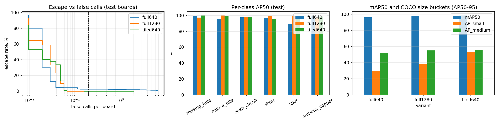
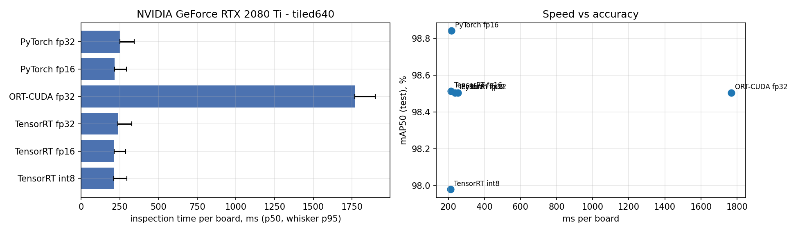

# PCB Defect Inspection with YOLO
### Tiled small-defect detection · AOI metrics (escape rate / false calls) · TensorRT FP16 & INT8 · FastAPI + Docker

Automated optical inspection (AOI) of bare printed circuit boards. A YOLO11 detector finds six defect types on full-resolution boards and is evaluated the way inspection-machine vendors report performance: by **escape rate** (defects missed), **false calls per board**, and **inspection time per board**, not only mAP. The deployed model runs on TensorRT (FP16, or INT8 with explicit calibration) behind a FastAPI service in Docker.

| Highlight (test set: 104 boards, 447 defects) | Result |
|---|---|
| Deployed model (chosen on the validation set) | YOLO11s on 640 px tiles with 25 % overlap |
| mAP50 / mAP50-95 | **98.5 %** / 55.5 % |
| Small-object AP: tiling vs resizing the whole board to 640 px | **53.7 %** vs 29.4 % |
| Escape rate at ≤ 0.2 false calls per board | **0.0 %** (0 / 447; 95 % upper bound 0.67 %) |
| TensorRT INT8: escape rate / mAP50 | 0.22 % (1 / 447) / 98.0 % |
| Inspection time per board, TensorRT FP16 (p50, end to end) | **215 ms** (about 16,700 boards/hour, single stream) |
| HTTP API throughput, 4 concurrent clients | 11.1 boards/s (about 40,000 boards/hour) |


---

## Contents
- [Problem](#problem)
- [Dataset](#dataset)
- [Approach](#approach)
- [Results](#results)
- [Repository structure](#repository-structure)
- [Quick start](#quick-start)
- [API reference](#api-reference)
- [Engineering notes](#engineering-notes)
- [Limitations and future work](#limitations-and-future-work)
- [References and licences](#references-and-licences)

---

## Problem

The six defect classes are `missing_hole`, `mouse_bite`, `open_circuit`, `short`, `spur` and `spurious_copper`. The boards are 2544–3056 px wide; the median defect is **64 × 63 px, 2.4 % of the board width**. Resizing a whole board to a standard 640 px detector input shrinks that median defect to about **14 px**. Three ways of handling this are compared, with the same model and hyper-parameters:

| Variant | Training input | Inference |
|---|---|---|
| `full640` | whole board resized to 640 px (baseline) | whole board at 640 px |
| `full1280` | whole board resized to 1280 px | whole board at 1280 px |
| `tiled640` | 640 × 640 crops at native resolution | 25–35 overlapping tiles per board (25 % overlap), merged back to board coordinates |

---

## Dataset

**PKU-Market-PCB** (Huang & Wei, 2019), original full-resolution release.

| | Value |
|---|---|
| Annotated boards / board designs | 693 / 10 |
| Defects | 2,953 (482–503 per class: balanced) |
| Board sizes | 2544 × 2156 to 3056 × 2464 px |
| Median defect | 64 × 63 px (2.37 % of board width) |
| Defect pixels as share of board area | 0.35 %: background outnumbers defects about 286 : 1 |
| Defect-free reference boards (`PCB_USED`) | 10, used only to measure false calls on good boards |
| Split: train / val / test boards | 485 / 104 / 104, stratified by defect class |
| Tiles per board (640 px, 25 % overlap) | median 25, max 35 |
| Tiled training set | 3,529 defect tiles + 3,496 sampled background tiles |

The augmented `rotation/` folder that ships with some copies of the dataset is excluded, because it would leak rotated copies of test boards into training.

**Class imbalance:** the six classes are balanced, so the imbalance that matters is defect vs background, the main driver of false calls. In tiled training it is controlled by sampling one background tile per defect tile.

---

## Approach

1. **Training:** Ultralytics YOLO11s (9.4 M parameters), identical hyper-parameters for all three variants, horizontal and vertical flips added to the defaults.
2. **Board-level evaluation:** every variant is scored the same way (whole board in, defects in board coordinates out) through one shared module, [`serve/app/pcb_core.py`](serve/app/pcb_core.py). The API imports the same module, so the offline metrics describe exactly what the service does.
3. **Tile merging:** detections touching an *interior* tile edge are dropped, because the 25 % overlap (160 px) is larger than nearly all defects, so each defect also appears whole in a neighbouring tile. Duplicates are then removed with class-aware NMS.
4. **AOI metrics:**
   - **Escape rate:** the share of real defects that no detection overlaps. Matching is class-agnostic with IoU ≥ 0.25: a defect detected with the wrong class still stops the board.
   - **False calls per board:** detections overlapping no real defect.
   - **Operating point:** the lowest confidence threshold with ≤ 0.2 false calls per board on the **validation** set. It is then frozen and applied unchanged to the test set and the good boards.
5. **Export:**
   - ONNX fp32 (fixed 640 × 640, dynamic batch, so one batch holds all tiles of a board).
   - **FP16** via NVIDIA ModelOpt AutoCast, which keeps the two overflow-prone box-decoding nodes in fp32.
   - **INT8** via ModelOpt post-training quantization: entropy calibration on 256 training tiles writes explicit Q/DQ nodes into the graph, and the Detect head is kept in fp16.
6. **TensorRT:** strongly typed engines for fp32, fp16 and INT8, built in an isolated process with an optimisation profile for batch 1–35, tuned for 25 tiles.

---

## Results

All numbers come from one run of [`notebooks/pcb_defect_yolo.ipynb`](notebooks/pcb_defect_yolo.ipynb). Raw values are in [`results/`](results/).

**Environment:** NVIDIA GeForce RTX 2080 Ti (Turing, 11 GB; also driving the display), driver 617.42, Windows 10, Intel Core i5-8400, Python 3.10.11, PyTorch 2.14.1+cu126, Ultralytics 8.4.191, TensorRT 11.4.0.106, ModelOpt 0.47.0, ONNX Runtime 1.22.0.

### 1. Tiling vs higher resolution (test set, PyTorch fp32, each at its own validated operating point)

| Variant | mAP50 | mAP50-95 | AP small | Conf. threshold | Escape rate | False calls / board | Good boards flagged | Board time p50 / p95 (ms) |
|---|---:|---:|---:|---:|---:|---:|---:|---:|
| full640 | 96.3 | 51.5 | 29.4 | 0.054 | 2.46 % | 0.15 | 2 / 10 | 86 / 121 |
| full1280 | 98.3 | 54.9 | 38.2 | 0.001 | 0.00 % | 0.27 | 0 / 10 | 125 / 140 |
| **tiled640** | **98.5** | **55.5** | **53.7** | 0.033 | **0.00 %** | 0.18 | 1 / 10 | 261 / 351 |

Validation escape rates (used to choose the deployed variant): full640 2.72 %, full1280 0.68 %, tiled640 0.00 %.

**Findings**
- **Resizing to 640 px costs exactly the small defects.** full640 reaches 96.3 % mAP50 but misses 2.5 % of the test defects at the false-call budget, and its small-object AP is 29.4 %. Tiling raises small-object AP to **53.7 %**, compared with 38.2 % for full-board 1280 px.
- **full1280 is a strong, cheaper alternative.** It is 2.1× faster per board and also had no escapes on the test set. With 447 test defects, an observed 0 % escape rate only bounds the true rate below about 0.7 % (95 %), so the escape-rate difference between full1280 and tiled640 on test is within noise. Tiling was chosen on the validation set (0.00 % vs 0.68 % escapes) and has the clearer small-object advantage. On a line with a tight takt time, full1280 would be a defensible choice.
- **Per-class:** the weakest class for full640 is `spur` (AP50 89.0 %), which tiling raises to 99.5 %.
- **mAP50-95 of about 55 %** reflects how tight the boxes are on 50–80 px defects at strict IoU thresholds. The accept/reject decision depends on detection, not box tightness, which is why escapes are measured at IoU ≥ 0.25.



### 2. Per-class AP50 / AP50-95 (test)

| Class | full640 | full1280 | tiled640 |
|---|---:|---:|---:|
| missing_hole | 99.7 / 60.4 | 97.3 / 60.4 | 99.9 / 64.2 |
| mouse_bite | 95.6 / 48.7 | 99.9 / 55.6 | 99.8 / 56.0 |
| open_circuit | 97.5 / 52.0 | 97.9 / 54.4 | 97.9 / 55.3 |
| short | 96.7 / 55.6 | 99.2 / 57.6 | 95.4 / 53.6 |
| spur | 89.0 / 45.2 | 99.2 / 52.6 | 99.5 / 49.9 |
| spurious_copper | 99.2 / 47.3 | 96.6 / 49.1 | 98.6 / 54.2 |

At the operating point, the tiled model assigned the correct class to every caught defect except one `spurious_copper` predicted as `spur`.

### 3. Deployment backends (tiled640, 104 test boards, about 25 tiles per board)

| Backend | mAP50 | mAP50-95 | Escape rate | False calls / board | Inference / board p50 (ms) | Board time p50 / p95 (ms) | Boards / hour |
|---|---:|---:|---:|---:|---:|---:|---:|
| PyTorch fp32 | 98.51 | 55.51 | 0.00 % | 0.18 | 116.9 | 252 / 344 | 14,266 |
| PyTorch fp16 | 98.84 | 55.48 | 0.00 % | 0.24 | 80.7 | 218 / 292 | 16,512 |
| TensorRT fp32 | 98.51 | 55.51 | 0.00 % | 0.18 | 101.8 | 237 / 328 | 15,174 |
| **TensorRT fp16** | 98.51 | 55.34 | 0.00 % | 0.26 | **76.9** | **215 / 288** | **16,741** |
| TensorRT INT8 | 97.98 | 55.10 | 0.22 % | 0.17 | 81.0 | 211 / 297 | 17,027 |
| ONNX Runtime CUDA fp32¹ | 98.51 | 55.51 | 0.00 % | 0.18 | 1,633 | 1,769 / 1,901 | 2,035 |

¹ Probably a configuration problem rather than a property of ONNX Runtime: this run used ONNX Runtime 1.22 (pinned by ModelOpt) with a dynamic batch of about 25 tiles. It is reported for completeness and is not treated as representative.

Board time is the whole inspection (JPEG decode, tiling, inference on all tiles, merging) on 60 test boards after warm-up.

**Findings**
- **TensorRT fp16 is the best choice on this GPU:** identical escape rate to fp32, 1.5× faster inference than PyTorch fp32, and a half-size engine.
- **INT8 brings no speed-up here.** INT8 inference (81 ms) is no faster than fp16 (77 ms), while it adds one escape (1 / 447) and drops mAP50 by 0.5 points. On Turing, YOLO11s at 640 px already runs efficiently on fp16 Tensor Cores, and the Q/DQ reformatting plus the fp16 Detect head offset the INT8 gain. The INT8 path is validated and kept for hardware where it pays off (e.g. Jetson-class edge devices or larger models), but **FP16 is the recommended default**.
- **The CPU, not the GPU, is the bottleneck.** About 60 % of the 215 ms board time is CPU work: roughly 30 ms to decode a 3000 px JPEG and about 70 ms to cut 25 tiles and convert them to float. The next optimisation is GPU-side pre-processing (uint8 input with normalisation inside the engine, nvJPEG decoding), not a faster model.



### 4. HTTP API (FastAPI, 1 worker, TensorRT INT8, whole 3000 px board JPEGs)

| Concurrent clients | Boards / s | Boards / hour | p50 (ms) | p95 (ms) |
|---:|---:|---:|---:|---:|
| 1 | 4.1 | 14,902 | 234 | 309 |
| 2 | 7.6 | 27,515 | 257 | 330 |
| 4 | 11.1 | 39,894 | 353 | 484 |

**Parity check:** on a test board, the API and the notebook's PyTorch fp32 model returned the same 5 defects (all 5 matched at IoU > 0.5), and those were exactly the 5 ground-truth defects. Throughput scales with concurrency because decoding and tiling of different boards overlap with GPU inference.

### 5. Error analysis (tiled640, test, operating point)

- **Escapes:** none at the operating point (fp32).
- **False calls (19 across 104 boards):**
  - **11** are predicted as `missing_hole`, including a recurring low-confidence (0.06) call at the same place on the board's top edge, where the board meets the grey background, on several boards of the same design. Production AOI avoids this with an inspection region-of-interest mask per board design.
  - A few high-confidence false calls (0.7) sit on features that resemble defects.
  - One `spur` false call overlaps a true defect but with IoU below 0.25, so it is a localisation mismatch rather than a hallucination.


---

## Repository structure

```
pcb-aoi/
├── notebooks/
│   └── pcb_defect_yolo.ipynb    # full pipeline with a step-by-step guide
├── serve/
│   ├── app/
│   │   ├── pcb_core.py          # tiling, decoding, NMS, merging: shared by notebook and API
│   │   ├── runners.py           # TensorRT (CuPy) and ONNX Runtime backends, engine cache
│   │   ├── build_trt_engine.py  # builds strongly typed TensorRT engines in an isolated process
│   │   └── main.py              # FastAPI endpoints
│   ├── Dockerfile               # CUDA 13 runtime, non-root user, health check
│   ├── docker-compose.yml       # GPU selection, engine-cache volume
│   └── requirements.txt
├── results/                     # metrics CSVs and figures from the run above
├── requirements.txt             # notebook / training environment
└── LICENSE
```

Generated at run time and not committed: `artifacts/` (datasets, training runs, ONNX models, TensorRT engines).

---

## Quick start

### Requirements
- NVIDIA GPU with compute capability ≥ 7.5 (developed on an RTX 2080 Ti)
- **NVIDIA driver R580 or newer** (required by the CUDA 13 TensorRT wheel)
- Python 3.10–3.12
- PKU-Market-PCB, original release with `images/`, `Annotations/` and `PCB_USED/`, downloaded separately

### 1. Install

```bash
git clone https://github.com/<your-username>/pcb-aoi.git
cd pcb-aoi
python -m venv .venv
# Windows: .venv\Scripts\activate    Linux: source .venv/bin/activate
pip install torch torchvision --index-url https://download.pytorch.org/whl/cu126
pip install -r requirements.txt
```

### 2. Run the notebook

```bash
# Linux:   export PCB_ROOT=/path/to/PCB_DATASET
# Windows: set PCB_ROOT=C:\path\to\PCB_DATASET
jupyter lab notebooks/pcb_defect_yolo.ipynb
```

Set `GPU_ID` in the first code cell on multi-GPU machines. Training all three variants takes about 3 h on an RTX 2080 Ti and can be resumed. A Roboflow YOLO export is also accepted (detected via `data.yaml`), but the notebook warns if the export was resized and re-splits it by original board if copies leak across splits.

### 3. Serve the API

**Without Docker** (Windows cmd; on Linux use `export`):

```bat
pip install fastapi "uvicorn[standard]" python-multipart cupy-cuda13x
cd serve
set MODEL_DIR=..\artifacts\deploy\pcb
set ENGINE_CACHE=..\artifacts\engines\serve
set BACKEND=trt
set PRECISION=fp16
set CUDA_DEVICE_ORDER=PCI_BUS_ID
set CUDA_VISIBLE_DEVICES=0
uvicorn app.main:app --port 8000
```

**With Docker** (NVIDIA Container Toolkit on Linux; Docker Desktop with WSL2 on Windows):

```bash
cd serve
docker compose build
GPU_ID=0 PRECISION=fp16 docker compose up -d
docker compose logs -f api        # wait for "Ready"
```

The first start builds the TensorRT engine for the GPU it runs on (2–3 min); restarts reuse the cached engine. Interactive docs: <http://127.0.0.1:8000/docs>

| Variable | Default | Meaning |
|---|---|---|
| `BACKEND` | `trt` | `trt`, `ort-cuda` or `ort-cpu` |
| `PRECISION` | `fp16` | `fp16`, `int8` or `fp32` |
| `CONF` | from `meta.json` (0.033) | override the validated operating threshold |
| `GPU_ID` | `0` | (compose only) GPU index as listed by `nvidia-smi` |

---

## API reference

| Method | Path | Description |
|---|---|---|
| GET | `/health` | Status, backend, runtime |
| GET | `/model` | Classes, tiling settings, operating point, test metrics |
| POST | `/inspect` | Board image → `PASS`/`FAIL` with a defect list (class, confidence, box) and timings; `?return_image=true` adds an annotated JPEG; `?conf=` overrides the threshold |
| POST | `/inspect/annotated` | Board image → annotated JPEG; verdict in the `X-Verdict` header |

```bash
curl -F "file=@01_spur_04.jpg" http://127.0.0.1:8000/inspect
```

The response looks like this (an illustrative example; values vary per board):

```json
{
  "verdict": "FAIL",
  "num_defects": 5,
  "defects": [
    {"class": "spur", "class_id": 4, "confidence": 0.91, "box": [1532.0, 845.5, 1598.2, 903.0]}
  ],
  "conf_threshold": 0.0328,
  "image_size": [3034, 1586],
  "timing_ms": {"decode_ms": 32.1, "tiling_ms": 73.6, "inference_ms": 280.9, "postprocess_ms": 7.7, "num_tiles": 25, "total_ms": 488.4}
}
```

---

## Engineering notes

- **Data quality first.** The first attempt used a Roboflow export of this dataset. It turned out to be stretched to 640 × 640, its augmentations put copies of 308 boards into both training and test, and its labels did not line up with the images: Ultralytics' own validation never exceeded 6 % mAP50. The notebook now detects resized exports, groups augmentations by original board before splitting, and refuses to reuse artifacts produced from a different dataset (fingerprint check).
- **One inference core for evaluation and production.** Tiling, decoding, NMS and merging live in `pcb_core.py`, imported by both the notebook and the API.
- **The operating point is chosen on validation and frozen.** Test-set numbers are never used for any decision, including which variant to deploy.
- **INT8 in TensorRT 11 needs explicit Q/DQ.** TensorRT 11 removed the builder-side INT8 calibrator. ModelOpt post-training quantization calibrates on representative training tiles (defect and background) and writes Q/DQ nodes into the ONNX graph, from which TensorRT builds the INT8 engine.
- **Precision is judged at the operating point.** INT8 is evaluated by escapes and false calls at the frozen threshold, not only by mAP. That is what showed INT8's extra escape and its lack of a speed gain on this GPU.
- **Engines are not portable.** They are tied to the GPU and the TensorRT version, so the container ships ONNX files and builds and caches engines on first start, keyed by model, TensorRT version and GPU.
- **Isolated engine builds.** Engines are built in a separate process, so PyTorch's CUDA libraries never share a process with TensorRT's (a source of hard crashes on Windows), and a native crash cannot kill the notebook kernel or the API.

---

## Limitations and future work

- **Dataset.** PKU-Market-PCB has synthetically added defects on 10 board designs, and the same designs appear in train and test, as in per-product AOI recipes. Generalisation to unseen designs and to real production defects is not measured.
- **Statistical power.** The test set has 447 defects and the good-board check only 10 boards. A 0 % escape rate bounds the true rate below about 0.7 %, and the good-board false-call rate is only roughly estimated. Production validation uses thousands of boards.
- **GPU shared with the display.** Benchmark timings include some interference from the Windows desktop.
- **Next steps:**
  - GPU pre-processing and nvJPEG decoding, since CPU work is about 60 % of board time;
  - an inspection region-of-interest mask per design, to remove the board-edge false calls;
  - batching tiles across boards to raise throughput;
  - golden-board (reference-image) comparison as a second opinion for low-confidence detections.

---

## References and licences

- W. Huang, P. Wei. *A PCB Dataset for Defects Detection and Classification.* arXiv:1901.08204, 2019.
- R. Ding, L. Dai, G. Li, H. Liu. *TDD-Net: A Tiny Defect Detection Network for Printed Circuit Boards.* CAAI Transactions on Intelligence Technology, 2019.
- F. C. Akyon, S. O. Altinuc, A. Temizel. *Slicing Aided Hyper Inference and Fine-tuning for Small Object Detection (SAHI).* ICIP 2022.

**Code:** AGPL-3.0, required because the project uses [Ultralytics YOLO](https://github.com/ultralytics/ultralytics), which is licensed under AGPL-3.0. A commercial product would need an Ultralytics Enterprise licence or a permissively licensed detector (e.g. YOLOX, RT-DETR).
**Dataset:** PKU-Market-PCB is not included; obtain it from its original source and follow its terms of use.

**Author:** Tanvir Hasib, MSc (Information Technology) candidate, Multimedia University, Malaysia
